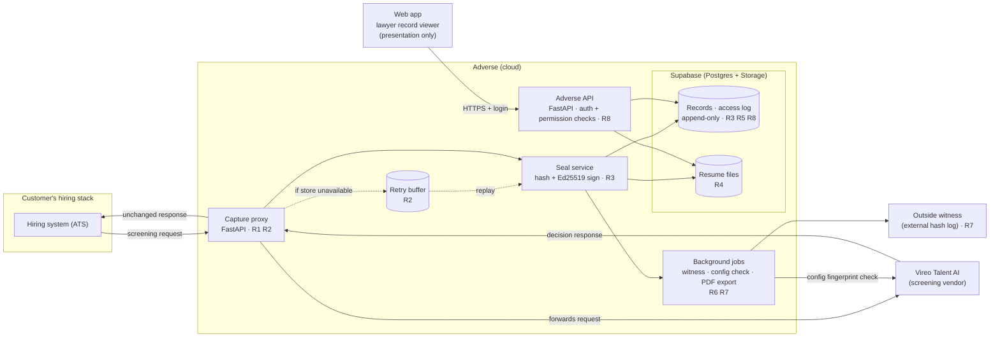

# CP-M3: Technical Architecture: Adverse

**Course:** IST 300 · Building Software with Agentic AI
**Author:** Alex Caraballo
**Project:** Adverse, an independent, tamper-evident record of AI hiring decisions for in-house employment lawyers
**Status:** Design. The current prototype is a single clickable screen (one lawyer viewing one decision record). Nothing below is built yet.

---

## 1. What this document answers

The PRD (CP-M2) says *what* Adverse does and *why*. This document says *how*: the stack, the layers, where each job runs, the data model, and the API. Every box in the architecture map traces back to a requirement from my D06 requirements list (R1–R8 below).

### Requirements this architecture has to satisfy

| ID | Requirement (from D06) |
|----|------------------------|
| R1 | Adverse captures the vendor's decision by sitting between the vendor (Vireo) and the company's hiring system, instead of relying on the vendor to send a separate copy. |
| R2 | If Adverse is down, hiring keeps working; the original response is buffered and captured when Adverse comes back. |
| R3 | Each record is sealed (hashed and signed) at capture, before anyone can change it. |
| R4 | The resume the model saw is stored for 4+ years and can be checked against its hash. |
| R5 | The vendor's explanation is stored verbatim. Adverse never generates, rewrites, or summarizes it with AI. |
| R6 | Vendor configuration is cross-checked against a settings fingerprint, and configuration changes are recorded. |
| R7 | A copy of each record's hash is sent to an outside witness, so tampering with Adverse's own database is detectable. |
| R8 | Every time a record is opened, the access log records it (on open, not on close), and the log cannot be edited or deleted. |

---

## 2. Architecture map

**Reading the map:** the hiring system talks to Vireo *through* Adverse's capture proxy. The proxy passes the response straight back to the hiring system (so hiring is never slowed by Adverse's work) and hands a copy to the seal service. Lawyers only ever reach the data through the API. Nobody touches the database directly.

---

## 3. Layers

I'm using the four-layer model from class (presentation, business logic, data access, data), plus one external piece.

| Layer | What it is in Adverse | Technology | Requirements |
|-------|----------------------|------------|--------------|
| Presentation | The lawyer's record page and access-log view. Displays data; makes no decisions. | Web app (React/Next.js) |: |
| Business logic | Capture proxy, seal service, permission checks, background jobs. | FastAPI (Python) | R1, R2, R3, R6, R7, R8 |
| Data access | The Adverse API: the only path in or out of the data. | FastAPI endpoints + Supabase server client | R8 |
| Data | Records, access log, configuration history, resume files. | Supabase (Postgres + Storage) | R3, R4, R5, R8 |
| External | Outside witness that holds an independent copy of each record hash. | External append-only log (see Open Questions) | R7 |

### Stack decision (from D06)

My real finalists were **Supabase vs. Firebase**, since both compete for the same jobs (login, permissions, record storage, access log). I chose **Supabase** because it's built on Postgres, which gives me data portability. Legal records have to outlive any one vendor, and I can export standard SQL in a way I can't with Firestore. The trade-off is that Supabase's free tier pauses inactive projects, which is fine for a class build but not for production.

**FastAPI isn't a competitor to Supabase.** It does a different job: Supabase is my data layer, not my whole back end. FastAPI holds the capture and sealing logic that has to run on a server I control.

---

## 4. What runs on the back end, and why

Browser code is readable by anyone, so anything that decides trust has to live on the server.

- **Sealing records (R3).** If the signing key were in the website code, anyone could forge seals. The Ed25519 private key lives only in the seal service's server environment.
- **The access log (R8).** If the browser did the logging, a user could skip it. The API writes the log entry *before* it returns the record, so you can't open a record without being logged.
- **Who sees what.** Hiding a button isn't security. The API checks the user's role on every request and refuses if they don't have access.
- **Capture, export, config checks, witness.** All server-side.

The **Supabase secret (service-role) key never goes in the web app.** The web app uses only the public key plus the user's login session, and Row Level Security blocks it from reading tables directly.

---

## 5. Key flows

### 5.1 Capture and seal (R1, R2, R3, R5)

1. The hiring system sends a screening request to Adverse's capture endpoint instead of directly to Vireo.
2. The capture proxy forwards the request to Vireo unchanged.
3. Vireo responds. The proxy returns the response to the hiring system immediately and unchanged.
4. In parallel, the proxy hands the full raw response (plus the request, timestamp, and resume) to the seal service.
5. The seal service hashes the resume (SHA-256), builds the record, hashes the full record, and signs the hash with Ed25519.
6. The record is written to an append-only table. The vendor explanation is stored as the raw string from the response; no model touches it (R5).
7. A background job is queued to send the hash to the outside witness (R7).

**If the data store is unavailable (R2):** the proxy still returns Vireo's response to the hiring system, and writes the raw response to a retry buffer. A background job replays the buffer once storage is back. The record keeps the *original* capture timestamp, plus a "sealed late" flag so a lawyer can see it was delayed.

### 5.2 Lawyer opens a record (R8)

1. Lawyer signs in on the web app (Supabase Auth).
2. Web app calls `GET /records/{id}`.
3. API checks the lawyer's permission for that record. If denied, it returns 403 and logs the denied attempt.
4. API writes an access-log entry (who, what, when).
5. Only then does it return the record.

### 5.3 Configuration check (R6)

A scheduled background job pulls Vireo's current model and threshold settings, computes a settings fingerprint, and compares it with the last one stored. If it changed, a new configuration-history entry is written. Each record stores the fingerprint that was in effect when it was captured.

---

## 6. Background jobs

These run asynchronously: the user sees "started" and the server finishes later.

| Job | Trigger | Requirement |
|-----|---------|-------------|
| Send hash to outside witness | After every seal | R7 |
| Replay retry buffer | When storage recovers | R2 |
| Vendor config fingerprint check | Schedule (e.g., hourly) | R6 |
| Build PDF export of a record | Lawyer requests export |: (PRD export story) |
| Verify stored resume hashes | Schedule | R4 |

---

## 7. Data model (first pass)

| Table | Key fields | Notes |
|-------|-----------|-------|
| `decision_records` | id, case_id, candidate_ref, job_id, decision, score, threshold, confidence_band, vendor_explanation (raw), model_version, settings_fingerprint, captured_at, sealed_late, record_hash, signature, signer_key_id | Append-only. No UPDATE or DELETE allowed (enforced by database permissions and a trigger). |
| `resumes` | id, record_id, storage_path, sha256 | File lives in Supabase Storage; retained 4+ years. |
| `config_history` | id, vendor, model_version, threshold, settings_fingerprint, configured_by, effective_from | One row per detected change. |
| `access_log` | id, record_id, user_id, action (open / export / denied), at | Append-only. |
| `record_access` | record_id, user_id, role, granted_by, expires_at | Who may see which record. |
| `witness_receipts` | record_id, witness_ref, sent_at | Proof the hash left Adverse. |
| `users` | managed by Supabase Auth | Roles: in-house lawyer, People Ops, outside counsel. |

---

## 8. API (contract between front end and back end)

| Method | Endpoint | Who calls it | Purpose |
|--------|----------|--------------|---------|
| POST | `/capture/vireo` | Hiring system | Proxy a screening request and capture the response |
| GET | `/records/{id}` | Web app | Get a record (logs the access first) |
| GET | `/records/{id}/access-log` | Web app | Read-only view of who opened it |
| POST | `/records/{id}/access` | Web app (lawyer) | Grant access to someone (e.g., outside counsel) |
| DELETE | `/records/{id}/access/{user}` | Web app (lawyer) | Remove access |
| POST | `/records/{id}/export` | Web app | Start a PDF export job |
| GET | `/verify/{id}` | Anyone with the record | Return the hash, signature, and public key for offline verification |

---

## 9. Design decisions

**Why it's not a monolith.** A monolith runs on one machine for one person. Adverse is multi-user by nature: the in-house lawyer, People Ops, outside counsel, and the capture service all depend on the same trusted record. A record only one person can see isn't evidence. The "monolithic equivalent" of Adverse is a lawyer saving screenshots to their laptop, which anyone could edit and no one else could check.

**Why there's no mobile app.** Lawyers review records at a desk. Adverse doesn't need a camera, location, microphone, or offline mode, so a mobile app wouldn't move the needle.

**Why there's no AI in the record path.** The value of Adverse is that the record is exactly what happened. Adding AI to summarize or "explain" decisions would undermine the one thing customers are paying for (R5).

---

## 10. Risks and open questions

- **I run the database.** Sealing proves a record hasn't changed since it was signed, but someone with database access could delete a whole record. The outside witness (R7) is my answer, but I haven't chosen one yet. Options: a public transparency log, a timestamping service (RFC 3161), or a second storage provider the customer controls. *Parked.*
- **Proxying live hiring traffic is a big ask.** Customers have to route Vireo calls through Adverse. If they won't, the fallback is a vendor-sent copy, which weakens R1. Needs customer discovery. *Parked.*
- **Key management.** Where the signing key lives in production (a managed key service vs. an environment variable) and how keys rotate. *Parked.*
- **Supabase free-tier pausing.** Fine for class, but a production deployment needs a paid tier.
- **Retention beyond 4 years and deletion requests.** Depends on legal requirements I still need to confirm with the attorney.
