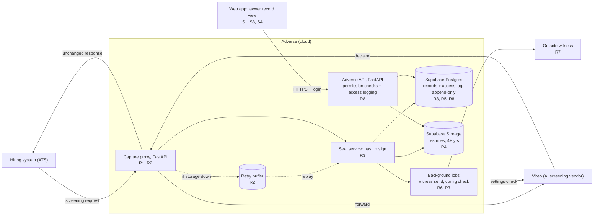

# Adverse architecture map (MVP slice)

Every box names the requirement it serves (R1 to R8 in docs/02-prd.md). Full write-up: docs/03-architecture.md.

## Request path traced: S1 (lawyer opens a decision record)

1. Browser: lawyer signs in and clicks a record. The web app calls GET /records/{id}.
2. API: checks the lawyer's permission for that record. If denied, it logs the attempt and returns 403.
3. API to database: writes an access-log entry (who, which record, when).
4. API to database and storage: reads the sealed record and the resume hash.
5. API: re-checks the seal and returns the record plus its verification status.
6. Browser: shows the record, the vendor explanation verbatim, and the seal status.
